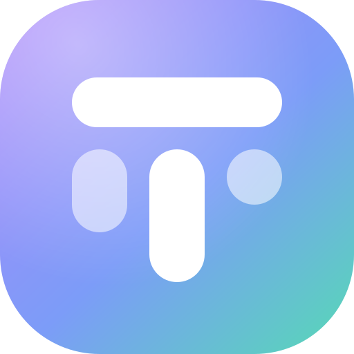

# 📋 TaskFlow — Modern Collaborative Kanban & Team Analytics

<div align="center">
  
  <h3>TaskFlow — Platform Manajemen Tugas Kolaboratif & Analisis Kinerja Tim</h3>
  <p>Dibangun dengan Next.js 15 (App Router), Tailwind CSS (Pastel Palette), @dnd-kit Sortable, Prisma ORM, dan SQLite.</p>

  <p>
    <a href="https://taskflow-production-41d9.up.railway.app"><strong>🌐 Buka Live Demo (Railway) »</strong></a>
  </p>
</div>

---

## 🚀 Sekilas Proyek

TaskFlow adalah aplikasi manajemen tugas Kanban enterprise-grade yang menggabungkan estetika modern bertema pastel lembut, animasi interaktif, serta modul analitik mendalam untuk memantau produktivitas dan evaluasi kinerja karyawan secara real-time.

Aplikasi ini sudah sepenuhnya **responsif** di seluruh perangkat (Mobile 320px, Tablet, hingga Desktop 4K) dan mendukung **PWA (Progressive Web App)**.

### 🔗 Live Deployment
- **Production URL:** [https://taskflow-production-41d9.up.railway.app](https://taskflow-production-41d9.up.railway.app)
- **Akun Demo Cepat:**
  - **Admin / Workspace Owner:** `demo@taskflow.dev` (Password: `password123`)
  - **Core Member (Sarah):** `sarah@taskflow.dev` (Password: `password123`)
  - **Core Member (Alex):** `alex@taskflow.dev` (Password: `password123`)

---

## ✨ Fitur Utama

### 1. 🗂️ Kanban Board Interaktif & Fluid
- **Drag & Drop Halus (@dnd-kit):** Mendukung pemindahan kolom (*horizontal sortable*) dan kartu tugas (*vertical & cross-column sortable*) secara presisi dengan algoritma *fractional indexing*.
- **Touch-Friendly & Snap Scroll:** Nyaman digeser di smartphone dengan *CSS scroll snap* dan affordance khusus layar sentuh (`hover-reveal`).
- **Pencarian & Filter Cepat:** Filter kartu secara instan berdasarkan nama, tingkat prioritas (*Urgent, High, Medium, Low*), dan label warna kustom.
- **Detail Tugas Komprehensif:** Modal interaktif untuk mengubah judul, deskripsi, tanggal jatuh tempo (*due date*), assignee anggota tim, dan checklist.

### 2. 📊 Dashboard & Reporting Kinerja Karyawan
- **KPI Summary Cards:** Menghitung total tugas, tingkat penyelesaian (*completion rate*), tugas tepat waktu (*on-time rate*), tugas *overdue*, dan rata-rata *lead time*.
- **Velocity Chart:** Visualisasi jumlah tugas yang diselesaikan per minggu atau per sprint.
- **Top Performers Podium:** Peringkat 3 besar kontributor terbaik dengan sistem medali dan rasio keberhasilan.
- **Tabel Evaluasi Anggota Tim:** Rincian beban kerja (*optimal, heavy, overloaded*), total tugas yang diemban, tugas sedang berjalan, dan riwayat aktivitas.

### 3. 🎨 Desain Modern Pastel & Dark Mode
- **Tema Pastel Elegan:** Menggunakan palet pastel lembut (*Lavender, Sky Blue, Mint, Peach*) dengan background *mesh gradient* yang nyaman di mata.
- **Dark Mode Support:** Transisi halus antara mode terang dan mode gelap dengan kontras warna yang terjaga.
- **Brand Identity & Iconography:** Dilengkapi logo SVG kustom berbentuk monogram "T" dan blok Kanban serta icon multi-resolusi untuk iOS dan Android.

---

## 🛠️ Tech Stack

- **Framework:** [Next.js 15](https://nextjs.org/) (App Router, Server Actions, React Server Components)
- **Bahasa:** TypeScript 5
- **Styling:** Tailwind CSS, Radix UI Primitives, Lucide Icons, Sonner Toast
- **Drag and Drop:** `@dnd-kit/core`, `@dnd-kit/sortable`, `@dnd-kit/utilities`
- **Database & ORM:** SQLite, [Prisma ORM](https://www.prisma.io/)
- **State & Optimistic UI:** React Optimistic Updates dengan rollback otomatis saat koneksi gagal
- **Hosting / Deployment:** Docker, Railway

---

## 💻 Panduan Instalasi Lokal

### 1. Prasyarat
- **Node.js:** v20.x atau v22.x (Rekomendasi: `v22.x`)
- **npm:** v10.x+
- **Git**

### 2. Clone Repository & Setup
```bash
# Clone repository dari GitLab
git clone git@gitlab.com:dandyzain.personal/taskflow.git
cd taskflow

# Install dependensi
npm install --legacy-peer-deps
```

### 3. Konfigurasi Environment & Database
Buat file `.env` di root project:
```env
DATABASE_URL="file:./dev.db"
JWT_SECRET="taskflow-super-secure-secret-key-2026"
```

Inisialisasi database SQLite dan seed data demo:
```bash
# Generate Prisma Client
npx prisma generate

# Jalankan migrasi database
npx prisma migrate dev --name init

# Seed data contoh (pengguna demo, board, kolom, kartu, label)
npx prisma db seed
```

### 4. Menjalankan Server Pengembangan
```bash
npm run dev
```
Buka browser di **http://localhost:3000**.

---

## 📖 Panduan Lengkap Pengguna

Dokumentasi lengkap panduan penggunaan, manual book pengujian, panduan peran (Role Guide), serta tips pemecahan masalah dapat dibaca di:
👉 **[USER_GUIDE.md](./USER_GUIDE.md)**

---

## 👥 Kontributor
- **Dandy Rahmat Zain** ([dandyzain.personal@gmail.com](mailto:dandyzain.personal@gmail.com))
